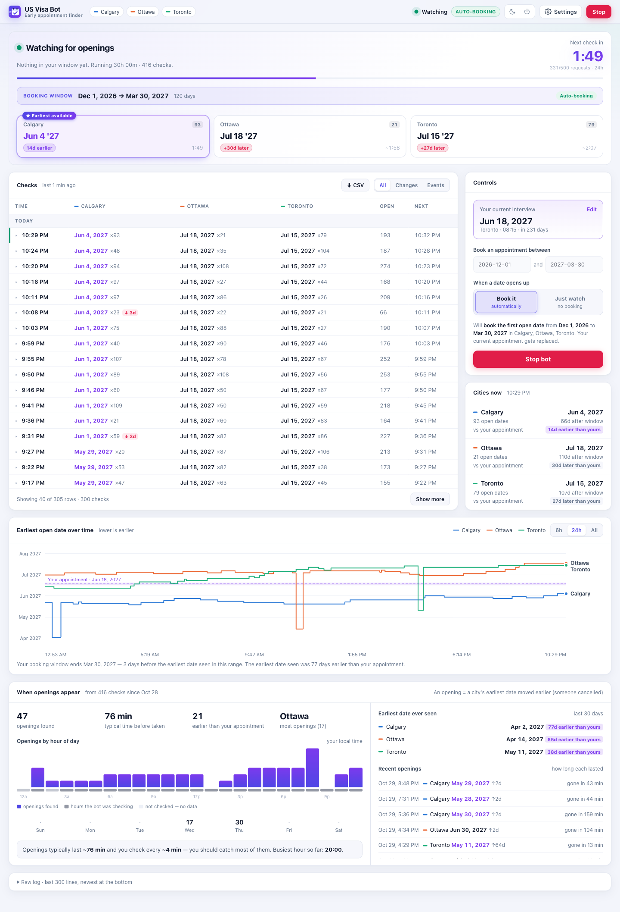
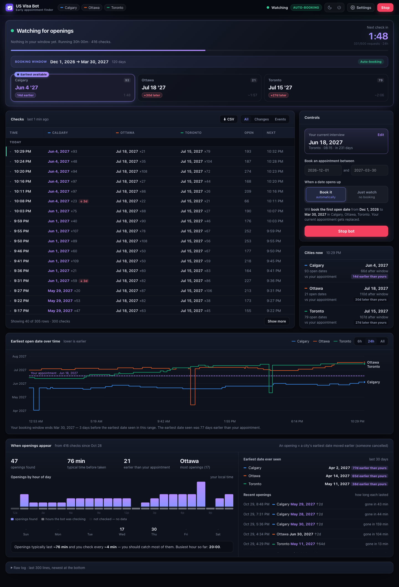
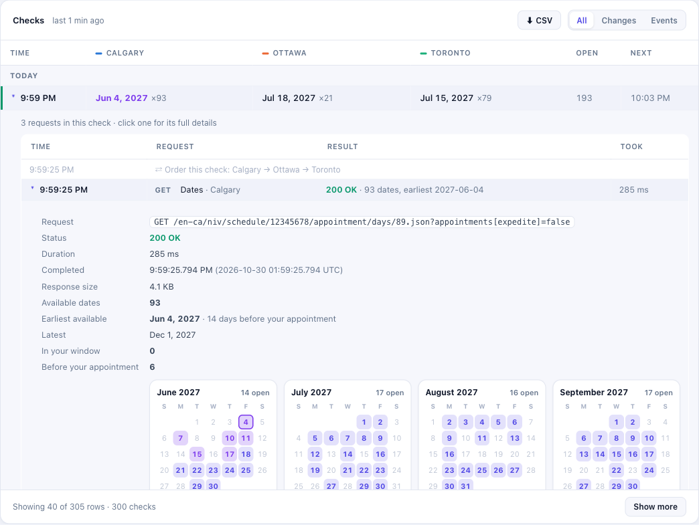
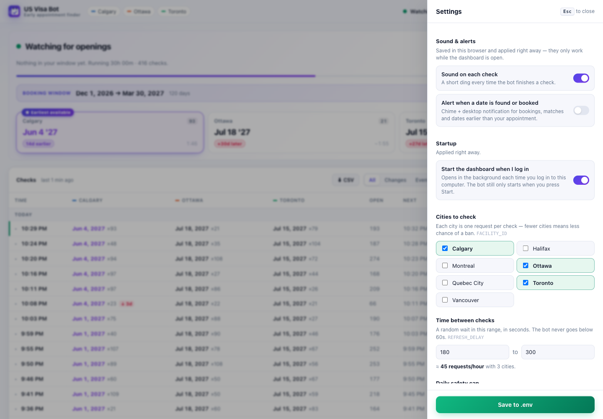
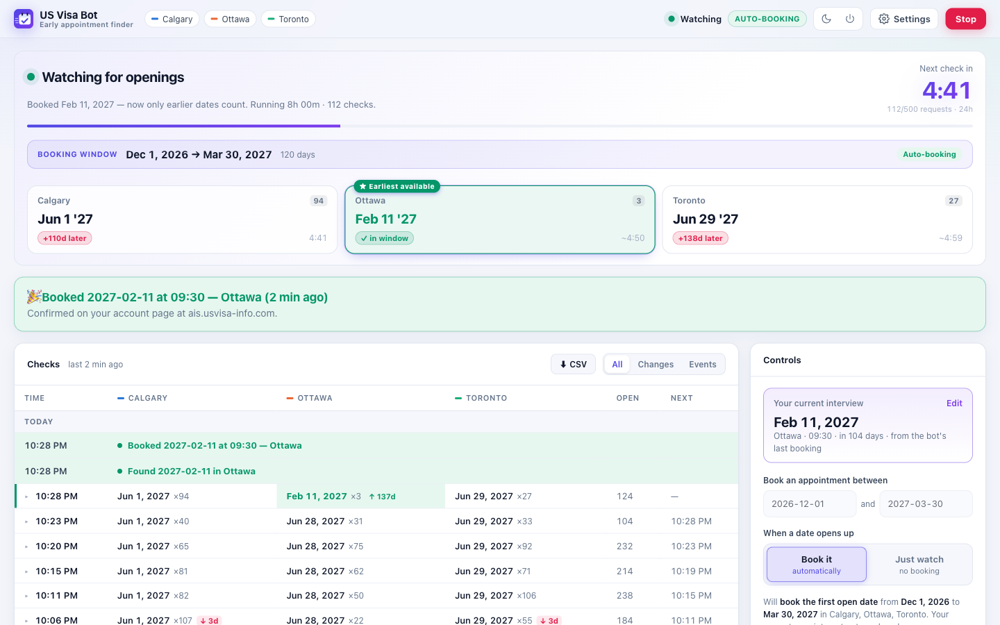
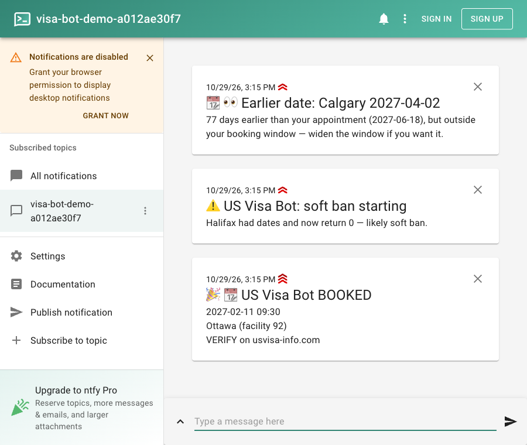

<p align="center">
  
</p>

<h1 align="center">US Visa Bot</h1>

<p align="center">
  <b>Early appointment finder</b> — watches the US visa appointment site (ais.usvisa-info.com) for an earlier interview date and books it for you, with a local dashboard to run it and see everything it finds.
</p>



## Features

- 🖥️ **Dashboard** — start/stop the bot from your browser, see every check live, and learn when cancellations appear ([details](#dashboard))
- 📅 **Books earlier dates automatically** within the window you choose, and **confirms each booking on your account page**
- 🏙️ **Several consulates at once** — e.g. Calgary, Ottawa and Toronto in one run
- 🛡️ **Paced to avoid bans** — random gaps, a daily request budget, and automatic backoff when the site pushes back
- 📱 **Phone alerts** (optional, via ntfy) when it books, when a soft ban starts, or when something needs your attention
- 🔐 **Signs out when stopped** and never shows your password
- 💻 **Windows, macOS and Linux**

## Quick start

You need [Node.js 20+](https://nodejs.org) and an existing US visa interview appointment.

```bash
git clone https://github.com/jeangnc/us-visa-bot.git
cd us-visa-bot
npm install
cp .env.example .env        # Windows: copy .env.example .env
```

Fill in `.env` (see [Configuration](#configuration)) — at least `EMAIL`, `PASSWORD`, `COUNTRY_CODE`, `SCHEDULE_ID` and `FACILITY_ID`. Then:

```bash
npm run ui                  # starts the dashboard in the background and opens http://localhost:4321
```

Pick your dates, choose **Book it** or **Just watch**, and press **Start**.

No terminal next time: double-click **`Visa Bot.cmd`** (Windows) or **`Visa Bot.command`** (macOS). Prefer the command line? See [Command line](#command-line).

## Dashboard

<details>
<summary>Dark mode</summary>



</details>

**Run it from the browser**
- **Pick a booking window** — "book an appointment between *date* and *date*" (both dates count). It's saved to `.env` (`BOOK_FROM`, `BOOK_TO`, `BOOK_MODE`) when you press Start, so it's still there after a Stop or a reload
- **Book it / Just watch** — book automatically, or only watch without booking anything
- **Start / Stop** — Stop signs the bot out of the site and confirms it
- Warns you if the window ends on or after your current appointment (the bot could move you *later*)

**See what's happening at a glance**
- **Live status** with a countdown to the next check — and, right inside it, a tile per city:
  - each city's **earliest open date** and how it compares to your interview — *✓ in window* (green), *20d earlier* (purple) or *+102d later* (red)
  - a **★ Earliest available** badge on the city with the earliest date you could book right now
  - how many dates each city has, a spinner on the city being asked right now, and a countdown to when each city is checked, in the bot's random order
- The **booking window it's working on** and whether it's auto-booking or just watching, with the request budget as a small line under the countdown
- **Your current interview** sits in Controls, next to the booking window — detected from the bot's last booking, or set by hand — and every date on the page is compared against it ("12 days earlier than yours")

**Every check, in a table**
- One row per check with each city's earliest date and how many dates it had; the check in progress fills in live, city by city, as the answers come back
- ↑/↓ when a city's earliest date moves, highlights for dates inside your window, and a warning when a city that had dates drops to zero (the soft-ban pattern)
- Sign-ins, sign-outs and stops have their own icons, so each session is easy to pick out; bookings, warnings and problems are coloured
- Filters: **All**, **Changes**, **Events** (sign-ins, backoffs, settings changes, bookings) — plus **CSV export**

**Click a check to see what the bot did**



Each check opens into its requests, in the order they ran: the random city order for that check, each request's result (status and what came back, e.g. *0 dates* or *105 dates, earliest May 20*) and how long the site took, and the random pauses in between. Slow or failed answers stand out in orange and red — an early sign of a block. **Click a request** for its full details: the exact address, the response size, and every date it returned as mini month calendars — open days filled, the earliest ringed, dates in your window in green, dates earlier than your appointment in purple (or the time slots, or the site's error message).

**Charts and insights**
- **Earliest open date over time** per city (6 h / 24 h / all), with your appointment as a reference line; stretches where every city returned nothing are shaded and labelled — the soft-ban pattern at a glance
- **Cities now** — each city's earliest date vs. your window and appointment
- **When openings appear** — an opening is a city's earliest date moving earlier (someone cancelled): openings by hour and weekday, how long they last before someone takes them, the earliest date ever seen per city, and recent openings
- A plain-English tip, e.g. *"Openings typically last ~79 min and you check every ~4 min — you should catch most of them."*

**Alerts**
- **Earlier than your appointment** — a date earlier than yours but outside your window is flagged (and sent to your phone), so you can widen the window
- **Browser notifications** and sounds: a short ding per check (optional), a chime when a date is found, a fanfare when it books

**Settings, applied live**



- Cities, time between checks (with a requests-per-hour estimate), daily request cap, and the ntfy topic (with **Send test**)
- Saved to `.env` and picked up by the running bot at its next check — no restart
- Your email and password are never shown or changed by the dashboard
- Light, dark or automatic theme
- A **raw log** at the bottom: the last 300 lines, following new ones as they arrive

### When it books



- The bot first **confirms the booking on your account page**. If the site rejected it, or the new date isn't there, you get a red *"Booking NOT confirmed"* event and alert, and your old date is kept
- A green **Booked** banner, and the **Found** / **Booked** events at the top of the table
- **Your appointment** switches to the new date and the status reads *"Booked Feb 11, 2027 — now only earlier dates count"*: the bot keeps running and will only move you **earlier**
- A celebration sound, a browser notification, and a push to your phone:



### Phone alerts

Install the [ntfy app](https://ntfy.sh) (iOS / Android), subscribe to a topic name only you know, put it in ⚙ Settings (or `NTFY_TOPIC` in `.env`) and press **Send test**.

| Alert | When |
|---|---|
| 🎉📆 **US Visa Bot BOOKED** (max priority) | It booked an appointment **and your account page shows the new date** |
| ⚠️📆 **CHECK your appointment** (max priority) | It tried to book, but your account page doesn't show the new date |
| ⚠️ **Booking failed** | The site rejected the booking; your appointment wasn't changed |
| 📆👀 **Earlier date: City date** | A date earlier than your appointment opened, outside your window |
| ⚠️ **Soft ban starting** | A city that had dates suddenly returns none |
| ✅ **City back** | That city returns dates again |
| ⚠️ **US Visa Bot STOPPED** | It gave up after repeated failures |

### Dashboard commands

| Command | What it does |
|---|---|
| `npm run ui` | Start the dashboard in the background and open it (if it's already running, just opens it) |
| `npm run ui:stop` | Stop the dashboard and the bot (the bot signs out first) |
| `npm run ui:autostart` | Start the dashboard when you log in — Windows (Startup folder), macOS (login item), Linux (autostart). Also a switch in ⚙ Settings. The bot still waits for you to press Start |
| `npm run ui:autostart:off` | Turn that off |

The bot keeps running if you close the browser tab. The ⏻ button in the top bar quits the dashboard (and optionally the bot). `bot.log` rotates automatically into `logs/`, and the dashboard only listens on `localhost`.

## Configuration

Copy `.env.example` to `.env` and fill it in:

```env
EMAIL=your.email@example.com
PASSWORD=your_password
COUNTRY_CODE=ca
SCHEDULE_ID=12345678
FACILITY_ID=89,92,94
REFRESH_DELAY=180-300
DAILY_REQUEST_CAP=500
NTFY_TOPIC=pick-a-hard-to-guess-name
```

| Variable | What it is | How to find it |
|----------|------------|----------------|
| `EMAIL`, `PASSWORD` | Your ais.usvisa-info.com login | — |
| `COUNTRY_CODE` | The part after `en-` in the site's URL | `https://ais.usvisa-info.com/en-{COUNTRY_CODE}/` — e.g. `br`, `fr`, `ca` |
| `SCHEDULE_ID` | Your appointment schedule ID | In the URL when rescheduling: `…/niv/schedule/{SCHEDULE_ID}/continue_actions` |
| `FACILITY_ID` | One or more consulate IDs, comma-separated | In network calls when picking dates, or the date selector dropdown. Paris = `44`; Canada: `89` Calgary, `90` Halifax, `91` Montreal, `92` Ottawa, `93` Quebec City, `94` Toronto, `95` Vancouver |
| `REFRESH_DELAY` | Seconds between rounds: a number or a random range | Optional, default `180-300`. Under 60 is raised to 60 |
| `DAILY_REQUEST_CAP` | Most requests in any 24 hours | Optional, default `500`. When reached, the bot waits instead of risking a block |
| `NTFY_TOPIC` | Phone alerts via [ntfy](https://ntfy.sh) | Optional — see [Phone alerts](#phone-alerts) |
| `BOOK_FROM`, `BOOK_TO`, `BOOK_MODE` | Your booking window (`BOOK_TO` inclusive) and `book` / `watch` | Optional. The dashboard saves them on Start; the command line uses them when no flags are given |

Everything except the login details is re-read before every round, so changes apply while the bot runs (it logs `settings updated: …`).

## Command line

You can run the bot without the dashboard:

```bash
node src/index.js [-c <date>] [-m <date>] [-t <date>] [--dry-run]
```

| Flag | Description |
|------|-------------|
| `-c`, `--current` | Book only dates **before** this one — usually your current appointment. Default: the day after `BOOK_TO` |
| `-m`, `--min` | Skip dates before this one. Default: `BOOK_FROM` |
| `-t`, `--target` | Exit once a date on or before this one is booked |
| `--dry-run` | Only log what would be booked. Default when `BOOK_MODE=watch` |

```bash
# Any date earlier than your current appointment on 2027-06-15
node src/index.js -c 2027-06-15

# Only between 2026-12-01 and 2027-02-28
node src/index.js -c 2027-03-01 -m 2026-12-01

# Watch only, using the window saved in .env
node src/index.js --dry-run
```

### What it does

1. **Signs in** with your `.env` credentials
2. **Checks** each facility in a new random order every round, with a random 5–12 s pause between them, then waits a random `REFRESH_DELAY` before the next round
3. **Books** a date in your window **the moment its city answers** — without waiting for the other cities — then **confirms** it on your account page — only then does it count (otherwise it logs `booking NOT confirmed` and keeps your old date)
4. **Keeps going** — the rest of that round and every round after — now only for dates earlier than the new one, until you stop it or `-t` is reached

```
[2026-10-29T19:02:57.988Z] request: GET sign-in page → 200 in 308ms
[2026-10-29T19:02:58.187Z] request: POST sign-in → 200 in 168ms
[2026-10-29T19:02:58.555Z] request: GET dates Calgary(89) → 200 in 412ms · 105 dates, earliest 2027-05-20
[2026-10-29T19:02:58.556Z] pause 7.4s before Ottawa(92)
[2026-10-29T19:03:06.012Z] request: GET dates Ottawa(92) → 200 in 288ms · 64 dates, earliest 2027-07-02
[2026-10-29T19:03:06.013Z] earliest per city: Calgary(89)=2027-05-20×105  Ottawa(92)=2027-07-02×64  [budget 148/500]
[2026-10-29T19:03:06.013Z] no good dates — 169 polled, 169 too late, 0 too early
[2026-10-29T19:03:06.014Z] sleeping 243.7s
```

### Live table in the terminal

Watch the bot as a table — one row per round, one column per city:

```bash
node src/index.js -c 2027-03-01 >> bot.log 2>&1   # terminal 1: the bot (or start it from the dashboard)
npm run watch                                      # terminal 2: Ctrl-C quits the table, not the bot
```

```
  TIME   │     CALGARY      │      OTTAWA      │     TORONTO      │ TOTAL │   NEXT
 14:31:07│ 2027-05-20 ×105  │      — none      │ 2027-06-25 ×33↑  │  138  │ 14:35:12
 14:35:24│ 2027-05-18 ×98↑  │      — none      │ 2027-06-25 ×31   │  129  │ 14:39:40
```

↑/↓ mark a city's earliest date moving earlier or later; sign-ins, backoffs and errors show as coloured banners; a booking prints a big box and rings the terminal bell. To watch another file: `npm run watch -- path/to/file.log`.

## Staying safe

The site rate-limits accounts that check too often: first a **soft ban** (every city returns no dates), then a **hard block** (dropped connections, even in your browser). The bot is built to avoid both:

- ✅ **No fixed pattern** — a random `REFRESH_DELAY` gap (never under 60 s), a new random city order every round, and 5–12 s between cities
- ✅ **Daily budget** — `DAILY_REQUEST_CAP` over a rolling 24 h, kept across restarts in `.request-budget.json`
- ✅ **Backs off when blocked** — a dropped connection pauses 1 h → 2 h → 4 h; a session error re-signs in after 5 min → 15 min → 1 h
- ✅ **Stops before making it worse** — after 4 failures in a row it exits and asks you to check the site by hand
- ✅ **Only books inside your window**, and confirms every booking on your account page
- ✅ **Signs out when stopped** (dashboard, `npm run ui:stop`, Ctrl-C) and confirms it; a booking in progress finishes first
- ✅ **Credentials stay in `.env`** — never shown in the dashboard or logs

If you see a soft ban, stop the bot for a few hours before trying again.

## Contributing

1. Fork the repository
2. Create a feature branch
3. Make your changes
4. Submit a pull request

## License

This project is licensed under the [PolyForm Noncommercial License 1.0.0](LICENSE).

Commercial use is not permitted. You may use, modify, and distribute this
software for noncommercial purposes — personal use, research, education, and
use by nonprofit and government organizations. Selling it, offering it as a
paid service, or using it as part of a commercial offering requires a separate
license. Contact the copyright holder to discuss commercial terms.

## Disclaimer

This bot is for educational purposes. Use responsibly and in accordance with the terms of service of the visa appointment system. The authors are not responsible for any misuse or consequences.
